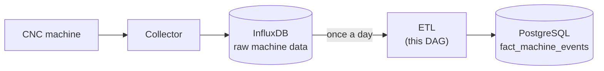
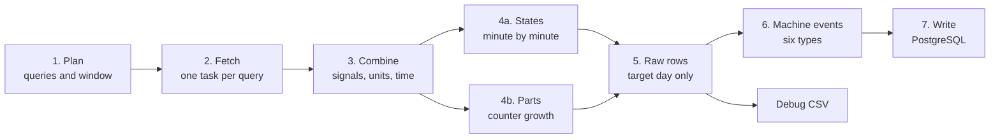

# How the ETL works

This page explains what the ETL does and why, starting from the big picture and moving step by step towards the code. Setup and configuration are covered in the [README](../README.md).

## The big picture



Once a day the ETL reads the previous day's raw machine data from InfluxDB, works out minute by minute what the machine was doing, and writes the result as machine events into the data warehouse.

The ETL does not collect data. That is the job of the collector, which stores the machine's values in InfluxDB as they change. The ETL does not create the target table either: the database owns its schema, and the ETL only checks that the table has the columns it needs.

## Concepts to know first

### Signals

The calculation needs eight values from the machine, such as the program name and the feed override. Every collector and controller names them its own way, so the ETL uses logical names, and the `signals` section of the configuration tells where each one is found in InfluxDB:

```yaml
signals:
  program: {measurement: mtc_status, name: pprogram}
```

The signals are of three kinds, and the kind decides how a reading is used:

| Kind         | Signals                                                          | What a reading means                         |
| ------------ | ---------------------------------------------------------------- | -------------------------------------------- |
| Time counter | `running_time`, `operating_time`, `cutting_time`, `spindle_time` | Total time so far. Only the growth matters.  |
| Set value    | `feed_override`, `spindle_override`, `program`                   | Valid until the next reading.                |
| Part counter | `part_count`                                                     | Grows by one when a part is finished.        |

The full list with the defaults is in the README section [Signals](../README.md#signals).

### Time counters: the growth tells the state

A time counter works like a car's odometer. It shows how many seconds the machine has been on, or running a program, in total. One reading says nothing; the growth during a minute does. From the synthetic test day:

| Time  | `running_time` grew | `operating_time` grew | `feed_override` | State               |
| ----- | ------------------- | --------------------- | --------------- | ------------------- |
| 05:30 | 0 s                 | 0 s                   |                 | Power off           |
| 06:15 | 60 s                | 0 s                   |                 | Idle                |
| 07:00 | 60 s                | 60 s                  | 100 %           | Efficient cutting   |
| 10:30 | 60 s                | 60 s                  | 30 %            | Inefficient cutting |

Growth counts only above `calculation.threshold` (5 s per minute), because the counters drift a little while the machine stands still. Cutting is efficient when the feed override is at least `calculation.override_threshold` (50 %). A counter that goes backwards has been reset, for example by a restart, and counts as no growth.

Consecutive minutes in the same state are joined into one period. The test day starts with one period of 361 minutes: the machine is off from midnight until the morning.

### Parts and cycle time

A part is finished when the part counter grows. The cycle time of a part is the time since the latest of these: the previous part, a reset of the counter, or loading the program. The time counters then tell how much of that time the machine actually worked.

The first part of the test day shows how this splits the time:

- The program is loaded at 06:00 and the part is finished at 06:41: the cycle time is **41 min**.
- During those 41 minutes `operating_time` grew by **11 min**: the program was running.
- The rest, 41 − 11 = **30 min**, is part change time: the machine was on but not running the program.

Cycle times shorter than `calculation.min_cycle_min` or longer than `max_cycle_min` (0.1 and 120 min by default) are left empty. A shorter one is a measurement artefact, and a longer one is in practice a break between parts.

### Two levels: raw rows and machine events

The calculation works in two levels:

1. **Raw rows.** The state periods and the parts, in time order. They are also written to daily CSV files for debugging.
2. **Machine events.** Six event types derived from the raw rows. These are written to PostgreSQL. The types are listed in the [README](../README.md#general).

The event types look at the same day at different scales: one state period (11, 14, 16), one part (10), one continuous run of a program (8) and the whole day (17). The same minute appears in several of them on purpose, so the types are not meant to be summed together.

### Clock error and the local day

Time is handled with two separate settings:

- `time.clock_error_hours`: how many hours the InfluxDB timestamps lag behind UTC. With correct timestamps this is 0.
- `time.timezone`: the local time, for example `Europe/Helsinki`. Daylight saving time follows from it automatically.

One run processes one local calendar day, from midnight to midnight. That is usually 24 hours, but 23 or 25 hours on the days the clocks change. The calculation itself is done in UTC, where an hour never repeats, and the result is turned into local time only when it is written.

The query reaches 12 hours past both ends of the day (`lookback_hours`, `lookahead_hours`), because a period can start before midnight and end after it. Rows outside the day are dropped in step 5.

## One run, step by step

Every run goes through the same steps. Each step is its own Airflow task, so a failed run shows exactly where it stopped.



1. **Plan.** Work out the target day and the query window, and derive the queries from `signals`. Nothing is fetched yet.
2. **Fetch.** One task per query, run in parallel. Only these tasks use the network, so they retry if InfluxDB does not answer.
3. **Combine.** Join the query results and give each reading its logical signal name. Convert the time counters to seconds and correct the clock error. Stop the run if a required signal is missing altogether.
4. **States and parts.** Two parallel branches from the same data: the state of every minute (4a), and the moments the part counter grew, with cycle times (4b).
5. **Raw rows.** Join both branches into one time-ordered list and keep only the rows of the target day.
6. **Machine events.** Derive the six event types from the raw rows.
7. **Write.** Delete the day's earlier rows of this machine and write the new ones, in one transaction.

In parallel with steps 6 and 7, the raw rows are written to a daily CSV file. After a successful run the intermediate files are removed.

### How the queries are derived

The signals are grouped into queries by their kind and measurement:

| Kind         | Query                                           | Why                                                                             |
| ------------ | ----------------------------------------------- | ------------------------------------------------------------------------------- |
| Time counter | Maximum per minute                              | Evens out the sampling without changing the counter's value                     |
| Set value    | Raw readings, and the last value before the window | Written only when changed. Without the earlier value, the program of a day with no program change would be unknown. |
| Part counter | Raw readings                                    | A reading from before the window would distort the first growth                 |

With the default signals this gives five queries: `counter_mtc_metrics`, `raw_mtc_metrics`, `raw_mtc_status`, `warmup_mtc_metrics` and `warmup_mtc_status`. The warm-up queries look back `time.warmup_days` (7 by default). If the machine has a `device` in the configuration, every query is limited to that device.

### From a raw row to an event

The first part of the test day is one raw row:

```text
2026-10-06 06:41:00+03:00  part  SIM-PROGRAM-A  cycle_min=41.0  operating_delta_min=11.0  cutting_delta_min=8.25
```

It becomes one event of type 10 (MACHINE PART CHANGE). Some of its fields:

| Field                      | Value            | From                                    |
| -------------------------- | ---------------- | --------------------------------------- |
| `start_at`, `end_at`       | 06:00, 06:41     | The part was finished at 06:41; the start is one cycle earlier |
| `unit_cycle_time_min`      | 41.0             | Cycle time                              |
| `unit_processing_time_min` | 11.0             | Growth of `operating_time`              |
| `cutting_time_min`         | 8.25             | Growth of `cutting_time`                |
| `non_cutting_time_min`     | 2.75             | Program running but not cutting: 11.0 − 8.25 |
| `part_change_time_min`     | 30.0             | Cycle time minus processing: 41.0 − 11.0 |
| `machine_active_pct`       | 0.2439           | Minutes in a cutting state (10) out of the cycle time (41) |

The dates and times are also written as local time in the forms YYYYMMDD and HHMMSS (`start_date` = `20261006`, `end_time` = `064100`). These are the keys of the warehouse's date and time dimensions.

## The DAG over time

**Schedule.** The DAG runs every day at 04:00 UTC and processes the previous local day, whose data is by then complete in InfluxDB. Missed days are not run automatically (`catchup` is off); they are run with a backfill. Only one run is active at a time.

**Manual runs.** The `Trigger` button in the Airflow UI asks for a date ("Ajopäivä"). Date ranges are run with Airflow's backfill.

**Running a day again.** With `target.write_mode: replace_day` (the default) a run first deletes the rows it wrote earlier for the same day, and then writes the new ones. The delete is limited to this machine (`workcenter_id`), this source (`source_id`) and the day, so other machines and other sources writing to the same table are not touched. Running a day twice gives the same result.

**Settings.** The configuration file is read at the start of every run, so a change applies to the next run without restarting Airflow. A missing machine, an unknown time zone or a configuration file in the old format stops the run at once with a message that tells what to fix.

**When InfluxDB does not answer.** The fetch tasks retry three times, waiting longer each time (up to 10 minutes). If a fetch still fails, the rest of the run is skipped. A whole run is stopped after 25 minutes.

**Stopping on purpose.** Some situations would give results that look right but are wrong, so the run stops instead: a query returns no rows, a required signal is missing altogether, or a column is missing from the target table. The error message names what is missing.

**Intermediate files.** The tasks pass data to each other as files under `data/staging/<run id>/`. They are removed after a successful run. After a failed run they are kept for 7 days (`files.staging_max_age_days`) for troubleshooting.

**Debug CSV.** The raw rows of each day go to `data/output/state-events_<date>.csv`, and the 90 newest days are combined into `state-events-all.csv`. They show where the events in PostgreSQL came from.

## From concepts to code

The DAG file `dags/mtconnect_data_dag.py` defines the schedule and the tasks. All of the calculation is in the package `config/python-venvs/mtconnect_data_dag/mtconnect_data_core/`. Reading its modules in this order follows the data:

| Step                    | File                | Main name                                                |
| ----------------------- | ------------------- | -------------------------------------------------------- |
| Task functions          | `vaiheet.py`        | One function per task, e.g. `combine_and_validate_raw_data()` |
| Settings                | `asetukset.py`      | `_load_config()`                                         |
| Signals and defaults    | `vakiot.py`         | `SIGNALS`, `DEFAULT_CONFIG`                              |
| Day and clock error     | `apurit.py`         | `_resolve_interval()`, `_from_influx()`                  |
| 1. Plan                 | `influx.py`         | `_signal_queries()`                                      |
| 2. Fetch                | `influx.py`         | `_build_query()`, `_query_influx()`                      |
| 3. Combine              | `influx.py`         | `_to_signals()`                                          |
| 4a. States              | `raakataso.py`      | `_classify_states()`                                     |
| 4b. Parts               | `raakataso.py`      | `_compute_part_changes()`, `_attach_cycle_counters()`    |
| 5. Raw rows             | `raakataso.py`      | `_build_events()`                                        |
| 6. Machine events       | `konetapahtumat.py` | `_build_machine_events()`                                |
| 7. Write                | `postgres.py`       | `_write_machine_events()`                                |

The module names are Finnish: *vaiheet* = steps, *asetukset* = settings, *vakiot* = constants, *apurit* = helpers, *raakataso* = raw level, *konetapahtumat* = machine events.

### Why the DAG file is so thin

The production Airflow runs the standard image, which does not have the InfluxDB client. If the DAG file imported it, the DAG would not load at all. That is why each task runs in its own virtual environment (`@task.external_python`), and the DAG file imports only Airflow and the Python standard library. Each task is three lines: add the package to the path, import it, and call one function in `vaiheet.py`.

The tasks pass only file paths and small summaries to each other. The data itself moves through files, because Airflow stores everything passed between tasks in its own metadata database.

### Extending

- **Another collector or controller:** no code changes. Set the names in `signals`, and in `source` the tags that name the item and the device.
- **A new signal:** add it to `SIGNALS` in `vakiot.py` with its kind and default source. It is then queried, renamed and checked like the others, and the calculation can use it by its constant.
- **A new event type:** a function in `konetapahtumat.py` that builds its rows on `_base_event()`, added to `_build_machine_events()`.

## Try it yourself

The fastest way to see all of this happen is the local test environment, which needs no machine or real database:

```bash
dev/setup.sh       # containers, configuration and the virtual environment
dev/seed.sh        # a synthetic day into InfluxDB
dev/run-day.sh     # the day through the DAG, and the result per event type
```

The synthetic day contains every event type: the machine is off at night, idles, cuts efficiently and inefficiently with two programs, and finishes 40 parts. The Airflow UI (http://localhost:8082) shows each task of the run, and its log shows the row counts of every step.

`dev/test.sh` runs the same synthetic day through the whole calculation without Airflow and compares the result to the expected files in `tests/odotetut/`. More options are in the README section [Dev setup](../README.md#dev-setup).
